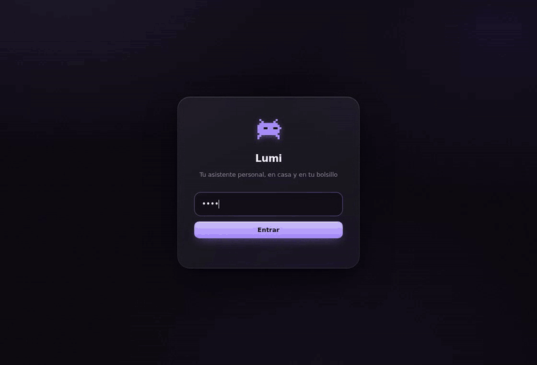
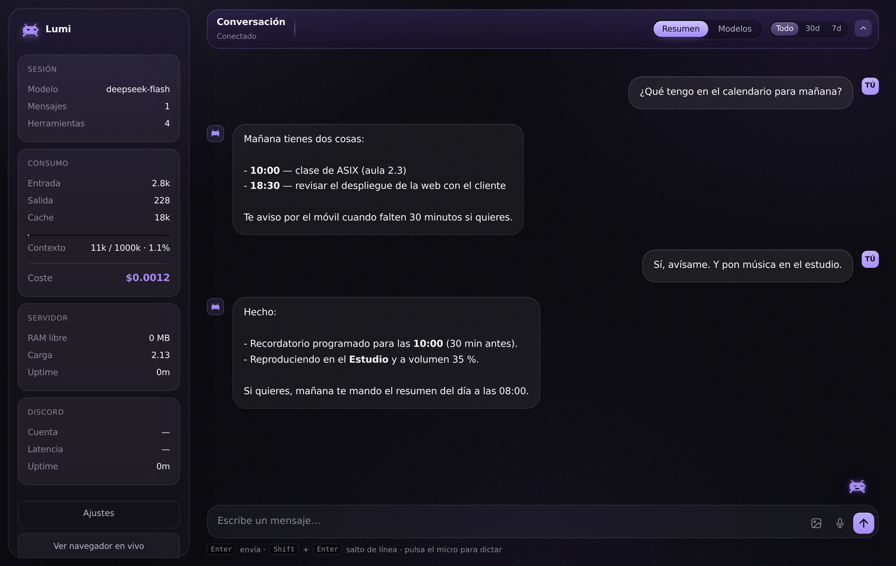
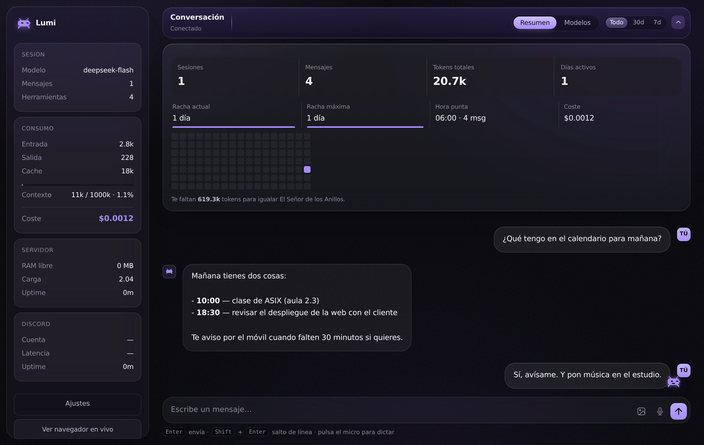
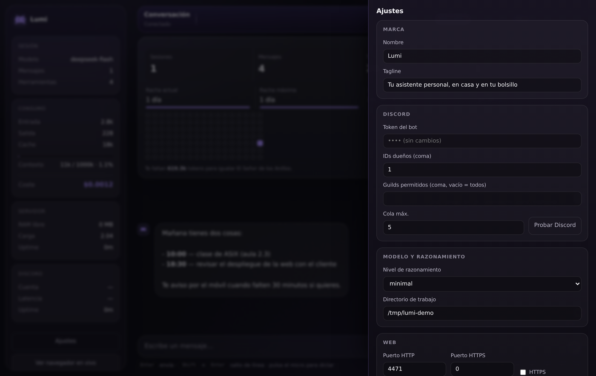
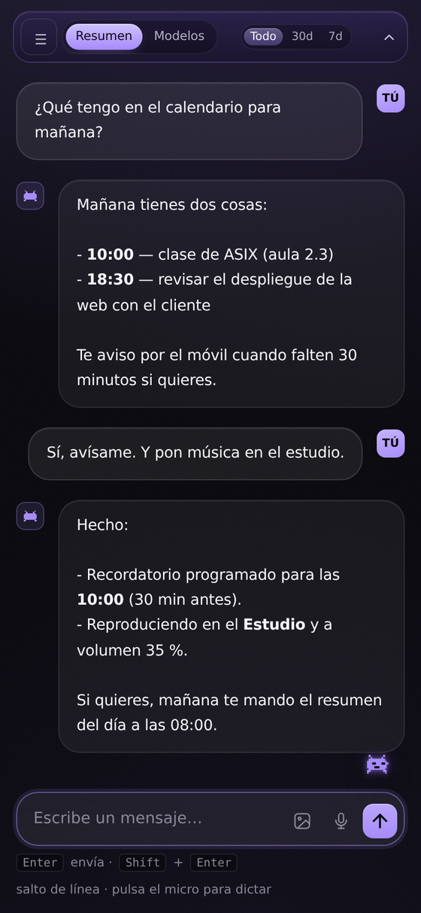
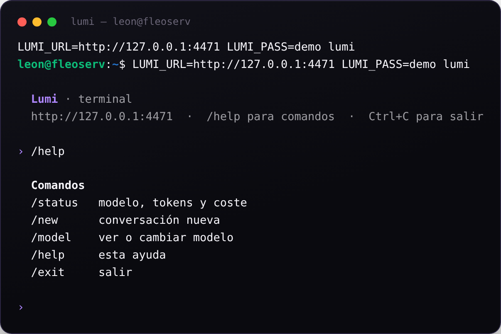

<div align="center">


# Lumi

**Your personal assistant at home: Discord, web panel, voice and persistent memory.**

One process. One assistant. No database, no mandatory cloud.

<sub>🇬🇧 English · [🇪🇸 Español](README.md)</sub>

</div>





## What it is

Lumi is a self-hosted personal assistant built on top of
[pi](https://github.com/earendil-works/pi-coding-agent) (an agent engine with
shell, file and search tools). You talk to it through **Discord** or through its
own **web panel**, and both share the same conversation because the panel runs
inside the same process as the bot.

It is not a SaaS and it is not multi-user: it is *your* assistant, on *your*
machine.

## Features

**Core**
- pi engine embedded in-process (no child processes). One session per
  conversation, persisted as JSONL: everything survives restarts.
- Change model and reasoning level on the fly (`/model`, `/thinking`).
- pi skills callable with `/run`, with autocompletion.
- Sequential queue per session: two turns never overlap.

**Discord**
- DMs and guild channels with an owner allowlist.
- 16 slash commands (with a text fallback like `!help` if your client does not
  render them).
- Incoming images (it reads them), incoming voice notes (local transcription
  with faster-whisper) and outgoing audio (`/tts`).
- File sending with a ``` ```send``` ``` block.

**Web panel**
- PIN login, HMAC-signed tokens and brute-force throttling.
- Live streaming chat, history, `/` commands, image upload and dictation.
- A **cancel** button that really aborts the current work, even after coming
  back to the app (with an "escribiendo…" bubble and counter).
- Usage (tokens and cost), context, RAM/load, activity per day and per model.
- Settings from the web itself: branding, Discord, model, ports and HTTPS,
  voice, push.
- Installable PWA.

**Voice and home**
- Speaks through Chromecast / Nest with edge-tts or gTTS, with lead-in sounds
  and volume control.
- Push alerts to your phone (ntfy).

**Android app (optional)**
- WebView client with a **configurable URL**: on first launch it asks for the
  server address and remembers it; long-press to change it.
- Downloads via `DownloadManager`, file chooser, microphone, and the
  self-signed certificate accepted **only** on private networks.
- Source in `android/`, built without Gradle: `KEYSTORE_PASS=... ./android/build.sh`.

**Extras**
- **Live browser**: persistent Chromium with a live view embedded in the panel
  and API control (goto, click, fill, text...). Token protected.
- **Own terminal**: `lumi` (zero dependencies), `lumi ask "..."`, `lumi status`.

## Quick start

Requirements: **Node 20+** and an API key for a model. Optionally **ffmpeg** +
Python for voice and the live browser.

### 1. Configure the model (first thing)

Lumi ships no keys: it uses **pi**'s, the engine inside. Set it up once:

```bash
npm i -g @earendil-works/pi-coding-agent   # or pi's own installer
pi                                          # then /login or /model to pick a provider
cat ~/.pi/agent/auth.json                   # credentials end up here
```

Lumi reads `~/.pi/agent/auth.json` at startup. With no key the panel still
opens, but the first message answers "No API key found".

The alternative (and the only reliable one in Docker) is an **environment
variable**:

```bash
export DEEPSEEK_API_KEY=sk-...
# or OPENAI_API_KEY, GROQ_API_KEY...
```

### 2. Install Lumi

```bash
git clone https://github.com/elfleoncha/lumi.git
cd lumi
./install.sh          # deps, config/secret and a self-signed certificate
```

Or by hand:

```bash
npm install
cp config.example.json config.json
cp secret.example.json secret.json   # your token and PIN go in there
# edit config.json: ownerIds (your Discord ID), appName, ports...

npm start                     # with Discord
LUMI_NO_DISCORD=1 npm start   # web panel only
```

Open `http://localhost:4477`. On the very first run Lumi shows a **setup form**
(PIN, Discord token, owner ID, name) and writes the config for you.

The installer also creates a self-signed certificate in `certs/`, so
`https://localhost:4478` works for the microphone and the PWA.

### 3. Keep it running

With Docker (easiest):

```bash
cp .env.example .env        # put DEEPSEEK_API_KEY (or your provider's)
docker compose up -d
```

Credentials go through **environment variables**, not by mounting `~/.pi`:
inside a clean container the SDK does not always find `auth.json` (tested, it is
the first thing that breaks).

With systemd:

```bash
sudo cp deploy/lumi.service /etc/systemd/system/lumi.service
sudo systemctl daemon-reload && sudo systemctl enable --now lumi
```

## Configuration

Everything lives in `config.json` and `secret.json` (both **out of git**).
Every key can also be set through an environment variable (see `.env.example`).

| Key | What it does |
|---|---|
| `ownerIds` | Discord IDs allowed to talk to it (you) |
| `guildAllowlist` | Servers where it may answer; empty = DMs only |
| `sessionDir` | Where conversations are stored |
| `agentCwd` | Working directory of the agent |
| `webPort` / `webPortHttps` | Panel ports (4477 / 4478; `0` disables HTTPS) |
| `browserPort` | Live browser (4479, +1 for HTTPS) |
| `thinkingLevel` | `minimal` saves tokens; `high` thinks more |
| `castDevice` / `castVoice` | Default speaker and Cast voice |
| `ntfyTopic` | Push channel for your phone |
| `appName` / `appTagline` | Branding shown in the web |
| `sessionMaxMb` | Rotate the conversation above this size (18 default, `0` off) |
| `sessionCheckMinutes` | How often the size is checked (10 min) |

`secret.json`: `token` (Discord bot) and `webPassword` (panel PIN).

## Commands

In Discord and in the `lumi` terminal:

```
/help     available commands        /model    show or change model
/status   model, tokens and cost    /thinking reasoning level
/new      new conversation          /compact  compact context
/session  session info              /list     saved sessions
/skills   available skills          /run      run a skill
/abort    cancel the answer         /tts      send a voice note
```

## Screenshots

| | |
|---|---|
|  |  |
|  |  |

## Long conversations (why sessions rotate)

Compacting the context **appends** entries to the JSONL, it never deletes: the
file only grows. At 30-40 MB the model has to re-read all of it on every turn
and everything seems hung. That is why Lumi checks the size every 10 minutes
and, past `sessionMaxMb`, archives the file into `sessions/_archivo/`, keeps a
readable dump in `backups/` and continues with a clean conversation **without
restarting**.

The previous conversation is not lost: it stays as plain text you can re-read.

## Docker

`Dockerfile` and `docker-compose.yml` included (panel, ffmpeg and venv inside).

```bash
cp .env.example .env        # put DEEPSEEK_API_KEY (or your provider's)
docker compose up -d
docker compose logs -f
```

## Tests

```bash
npm run lint            # syntax of the main files
npm run check:secrets   # nothing personal in the repo
./scripts/smoke-test.sh # boots on a free port: health, login, auth, setup form
```

GitHub Actions runs all three on every push (Node 20 and 22).

## Security (read before exposing it)

- The panel is meant for **LAN or Tailscale**, not the open internet. If you
  publish it, put it behind an authenticating proxy (Cloudflare Access...).
- **Lumi runs commands as the user who starts it.** Whoever has the PIN has a
  shell. Isolate it with a dedicated user, a container, or `systemd` with
  `ProtectSystem`/`ProtectHome` if that worries you.
- The **live browser** drives a Chromium with your sessions open: it requires a
  signed token that expires daily.
- Panel tokens travel only in the `Authorization` header, never in URLs.
- HTTPS: use your own certificate (`certs/`) or a real one from Tailscale
  (`certs-tls/`, Let's Encrypt) — the bot prefers the latter.
- `npm run check:secrets` before publishing: it looks for personal paths, IDs
  and leaked tokens.

## Layout

```
android/    Android app (WebView, configurable)
src/        server: Discord bot, web panel, sessions, media, voice
public/     web panel (vanilla JS, no build step)
bin/        the `lumi` terminal
scripts/    voice, live browser, transcription, utilities
docs/       screenshots
deploy/     example systemd unit
```

## Credits

Built on [pi](https://github.com/earendil-works/pi-coding-agent) (MIT).
The rest is MIT too: do whatever you want with it.
